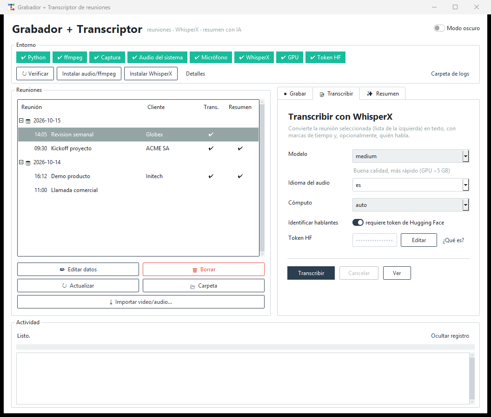
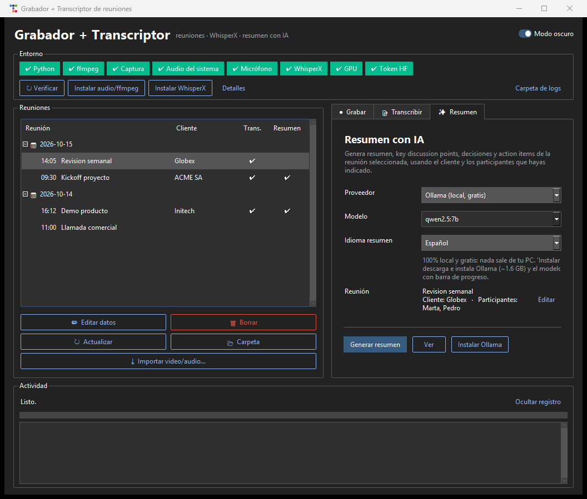
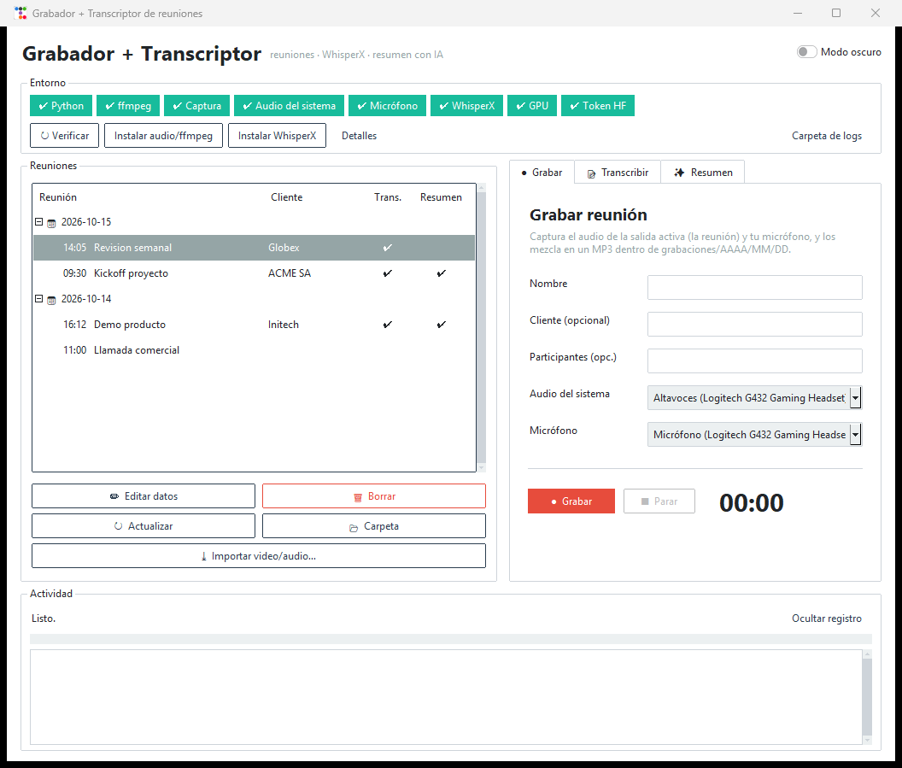

# 🎙️ Meeting Recorder — edición **Windows**

> [!IMPORTANT]
> **Esta rama es exclusiva para Windows 10/11.** Es una aplicación de escritorio en Python, con interfaz gráfica
> moderna, que **graba tus reuniones, las transcribe con IA y genera el resumen con action items**, todo desde una sola
> ventana y sin instalar drivers de audio ni ser administrador.
> Los scripts para macOS/Linux (`grabar.sh`, `install.sh`, `mp4towav.sh`) siguen en el repositorio, pero **no son el
> foco de esta rama**.

<p align="center">
  
  
</p>

## Qué puedes hacer

| | Función | Detalle |
|---|---|---|
| 🔴 | **Grabar** | Captura a la vez el **audio del sistema** (la voz de los demás en Teams, Zoom, Meet…) y **tu micrófono**, y los mezcla en un MP3 normalizado. Sin "Mezcla estéreo" ni VB-Cable. |
| 📝 | **Transcribir** | [WhisperX](https://github.com/m-bain/whisperX) en tu PC (GPU NVIDIA o CPU): texto con marcas de tiempo, idioma elegible y **quién habla** (opcional). |
| ✨ | **Resumir** | Resumen, *key discussion points*, decisiones y **action items** (acción / responsable / fecha) con **Ollama (local y gratis)**, **Claude**, **Gemini** o **ChatGPT**. Idioma del informe a elección (Español por defecto). |
| 🗂️ | **Organizar** | Carpetas `AAAA/MM/DD` automáticas, **renombrar**, **borrar** (a la Papelera) y datos opcionales de **cliente** y **participantes** que viajan al resumen. |
| 📥 | **Importar** | Convierte cualquier video/audio (mp4, m4a, mp3, wav, mkv, webm…) para transcribirlo como si lo hubieras grabado. |
| 🎨 | **Interfaz** | Modo **claro/oscuro**, estado del entorno en un vistazo, progreso en vivo de instalaciones, descargas de modelos y transcripción, y **recuerda tus últimos ajustes**. |
| 🛠️ | **Autodiagnóstico** | Verifica el entorno, instala lo que falta con un clic y, si algo falla, te dice **la causa probable y cómo corregirla**. |

## Requisitos

- **Windows 10 u 11** (64 bits).
- **Python 3.10 – 3.12** (recomendado 3.12). Se instala con un comando, ver abajo.
- **Internet** la primera vez (dependencias y modelos).
- **Espacio en disco:** ~8 GB libres para WhisperX + PyTorch; más si usas Ollama (~1.6 GB + ~5 GB por modelo).
- *Opcional pero recomendado:* **GPU NVIDIA** (probado con RTX 3060 de 12 GB) para transcribir mucho más rápido.
- **No necesitas permisos de administrador.** Todo vive dentro de la carpeta del proyecto (`.venv`, `.tools`, `logs`).

## Inicio rápido

```powershell
# 1) Python (una sola vez; marca "Add to PATH" si usas el instalador gráfico)
winget install Python.Python.3.12

# 2) Descarga esta rama
git clone -b claude/relaxed-goldberg-cuuba3 https://github.com/ccruzado/meeting-recorder.git E:\meeting-recording

# 3) Abre la aplicación
E:\meeting-recording\iniciar.bat
```

La primera vez `iniciar.bat` crea el entorno `.venv` e instala lo básico (captura de audio, ffmpeg incluido y la
interfaz). Las siguientes veces **abre directamente la ventana**, sin consola negra.
Para actualizar: `git pull` y vuelve a abrir `iniciar.bat`.

### Primer uso (3 pasos en la propia app)

1. **Entorno:** revisa los *chips* de arriba. Verde = listo; naranja/rojo = falta algo (pasa el mouse por encima para ver el detalle).
2. **Instalar WhisperX:** botón en la franja *Entorno* (~3 GB; con GPU NVIDIA cambia solo PyTorch a la versión con CUDA). Puede tardar 5–20 min: verás barra de progreso, MB descargados y tiempo.
3. **Graba o importa** una reunión y listo. Los modelos de transcripción se descargan la primera vez (verás el avance).

## Cómo se usa

<p align="center"></p>

La ventana tiene **a la izquierda tus reuniones** (agrupadas por fecha, con cliente y marcas ✔ de transcripción y resumen)
y **a la derecha tres pestañas**. Abajo, siempre, el panel **Actividad** con el progreso y el registro de lo que hace la app.

### ● Grabar
Escribe un **nombre** (y, si quieres, **cliente** y **participantes**), elige la salida de audio y el micrófono, pulsa
**Grabar** y al terminar **Parar**. Se mezcla y guarda en `grabaciones/AAAA/MM/DD/`. Si cambias de auriculares, elige el
dispositivo nuevo en la lista.

### 📝 Transcribir
Selecciona una reunión a la izquierda y elige:

| Opción | Valores |
|---|---|
| **Modelo** | `large-v3` (mejor calidad, ~8 GB VRAM) · `medium` (equilibrado, ~5 GB) · `small` (rápido) |
| **Idioma del audio** | `es`, `en`, `pt`, `fr`, `de`, `it` (o cualquier código ISO) |
| **Cómputo** | `auto` · `gpu` (CUDA) · `cpu` |
| **Identificar hablantes** | Separa SPEAKER_00, SPEAKER_01… (requiere token de Hugging Face, ver abajo) |

Resultado: `NOMBRE.md` (legible, con marcas de tiempo y hablantes) y `NOMBRE.json` (datos completos).

### ✨ Resumen
Elige **proveedor**, **modelo** e **idioma del resumen** y pulsa **Generar resumen**. Se guarda `NOMBRE.resumen.md` junto a
la transcripción y se abre solo.

| Proveedor | Costo | Privacidad | Qué necesitas |
|---|---|---|---|
| **Ollama** (local) | Gratis | Nada sale de tu PC | Botón **Instalar Ollama**: descarga e instala Ollama (~1.6 GB) y el modelo (~5 GB) **solo**, con barra de progreso |
| **Claude** (Anthropic) | De pago por uso | La transcripción se envía al proveedor | API key |
| **Gemini** (Google) | Tiene plan gratuito | La transcripción se envía al proveedor | API key |
| **ChatGPT** (OpenAI) | De pago por uso | La transcripción se envía al proveedor | API key |

- Las **API keys** se pegan en la app, se guardan en tu PC y se cambian con **Editar**. El botón *Obtener key* abre la página oficial.
- Con APIs en la nube la app **te avisa antes** de enviar la transcripción.
- Los nombres de modelo son sugerencias y el campo es editable por si el proveedor los renueva.

El informe incluye: **Resumen · Key discussion points · Decisiones · Action items (tabla) · Pendientes/riesgos**,
más el **cliente y los participantes** si los indicaste. El texto lo controla [`prompts/resumen.md`](prompts/resumen.md):
edítalo para cambiar formato o tono. Marcadores disponibles: `{{IDIOMA}}`, `{{CLIENTE}}`, `{{PARTICIPANTES}}`, `{{TRANSCRIPCION}}`.
También sirve para pegarlo tal cual en cualquier chat de IA.

### 🗂️ Gestionar reuniones
- **Editar datos** (botón, doble clic o clic derecho): cambia el **nombre** y completa **cliente** y **participantes**. Al renombrar se actualizan juntos audio, transcripción, resumen y datos; la fecha y hora originales se conservan.
- **Borrar** (botón o tecla `Supr`): pide confirmación y envía todo a la **Papelera de reciclaje**, así que se puede recuperar.
- **Importar video/audio…**, **Actualizar** y **Carpeta** (abre la carpeta de la reunión).
- Las grabaciones antiguas sueltas en `grabaciones/` se **ordenan solas** en `AAAA/MM/DD` al abrir la app.

## 🔑 Token de Hugging Face (solo para "Identificar hablantes")

Sin token la transcripción funciona igual, solo que sin separar voces. Es **gratis** y todo se procesa en tu PC. Una sola vez:

1. Crea una cuenta en <https://huggingface.co>.
2. Abre <https://huggingface.co/pyannote/speaker-diarization-community-1> y pulsa **Agree and access repository**.
3. Crea un token tipo *Read* en <https://huggingface.co/settings/tokens>, pégalo en **Token HF** y pulsa **Guardar** (el campo se bloquea; usa **Editar** para cambiarlo).

La app comprueba el acceso **antes** de transcribir y, si falta algo, te lo indica y abre la página correcta.

## 📁 Dónde se guardan las cosas

```
meeting-recording/
├─ grabaciones/
│  └─ 2026/10/14/
│     ├─ 2026-10-14_10-09-50_Kickoff.mp3          ← audio mezclado
│     ├─ 2026-10-14_10-09-50_Kickoff.md           ← transcripción
│     ├─ 2026-10-14_10-09-50_Kickoff.json         ← datos de WhisperX
│     ├─ 2026-10-14_10-09-50_Kickoff.resumen.md   ← resumen con IA
│     └─ 2026-10-14_10-09-50_Kickoff.meta.json    ← cliente y participantes
├─ prompts/resumen.md       ← prompt editable del resumen
├─ logs/                    ← instalacion.log · transcripcion.log · error.log
└─ grabar_app/              ← código fuente
```

Archivos locales que **nunca se suben a git** (están en `.gitignore`):

| Archivo / carpeta | Contenido |
|---|---|
| `grabaciones/` | Tus audios, transcripciones y resúmenes (datos privados) |
| `config.json` | Últimos ajustes: tema, pestaña, dispositivos, modelo, idioma, cómputo, proveedor… |
| `.hf_token` · `.api_keys.json` | Tu token de Hugging Face y tus API keys (texto plano local: no compartas la carpeta) |
| `.venv/` · `.tools/` · `.nltk_data/` | Entorno de Python, ffmpeg/Ollama descargados y datos de lenguaje |
| `logs/` | Registros detallados para diagnosticar problemas |

## ⚙️ Variables de entorno (opcionales)

| Variable | Para qué |
|---|---|
| `GRABAR_DIR` | Cambiar la carpeta base de grabaciones |
| `GRABAR_LANG` | Idioma de transcripción por defecto (`es`) |
| `GRABAR_DEVICE` | Forzar `cpu` o `cuda` |
| `GRABAR_FFMPEG` | Ruta a un `ffmpeg.exe` propio |
| `HF_TOKEN` | Token de Hugging Face (si no lo guardas desde la app) |
| `OLLAMA_URL` | Servidor de Ollama (por defecto `http://127.0.0.1:11434`) |

## 🖥️ Modo terminal (opcional)

`iniciar.bat cli` abre un menú de texto: grabar, parar, transcribir, importar y verificar el entorno. El resumen y la gestión
de reuniones están solo en la interfaz gráfica.

## 🩺 Solución de problemas

La app muestra la causa probable en el mensaje de error; el detalle completo está en `logs/`. Casos frecuentes:

| Síntoma | Qué hacer |
|---|---|
| **La instalación de WhisperX parece colgada** | No lo está: son ~3 GB. Mira la barra (MB descargados). Con red lenta puede tardar más de una hora; si se corta, vuelve a pulsar el botón y retoma. |
| **"PyTorch SIN CUDA"** o error con `gpu` | Pulsa **Instalar WhisperX** otra vez (reinstala PyTorch con GPU) o usa `cpu`. Actualiza el driver de NVIDIA si CUDA no se activa. |
| **Falta aceptar condiciones del modelo de hablantes** | Abre el enlace del apartado del token y pulsa *Agree*; vuelve a transcribir. |
| **Error 401 / 403 / 429 al resumir** | Key inválida, sin permiso o cuota agotada: revisa la key y tu plan. Error 404: cambia el nombre del modelo. |
| **Ollama no arranca o no descarga el modelo** | Ábrelo desde el menú Inicio y reintenta; revisa tu conexión (la descarga se retoma). |
| **Sin espacio en disco** | Libera ~8 GB (WhisperX) o más si usas modelos de Ollama. |
| **No aparece el audio del sistema** | Activa unos altavoces/auriculares en *Configuración › Sonido* y pulsa **Verificar**. |
| **Avisos de `torchcodec` en `logs/transcripcion.log`** | Son inofensivos; WhisperX no usa ese componente. |
| **Algo quedó corrupto** | Cierra la app, borra la carpeta `.venv` y abre `iniciar.bat` de nuevo. |
| **La app no abre** | Revisa `logs/error.log`. |

## 🔒 Privacidad

- La grabación, la transcripción y los hablantes se procesan **100 % en tu PC**.
- Solo el **resumen con Claude/Gemini/ChatGPT** envía la transcripción a un tercero (y la app lo avisa). Con **Ollama** no sale nada.
- Respeta la ley y las políticas de tu organización: **avisa a los participantes y obtén consentimiento** antes de grabar una reunión.

## 🧩 Para desarrolladores

- Python + `tkinter`/[`ttkbootstrap`](https://github.com/israel-dryer/ttkbootstrap) 1.10.1; captura con `PyAudioWPatch` (WASAPI loopback); `imageio-ffmpeg`.
- `grabar_app/core.py` (entorno, grabación, transcripción) · `library.py` (renombrar/borrar/datos) · `resumen.py` (Ollama y APIs, solo `urllib`) · `settings.py` (preferencias) · `gui.py` / `cli.py`.
- Las llamadas a las APIs usan únicamente la librería estándar: no hay SDKs que instalar.
